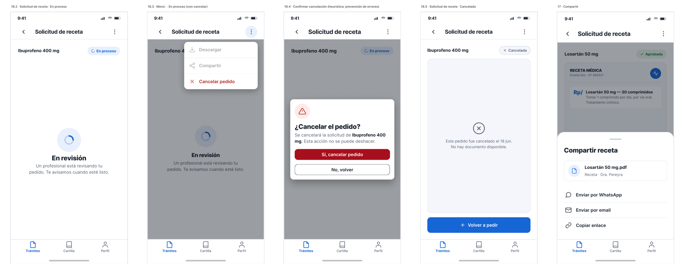
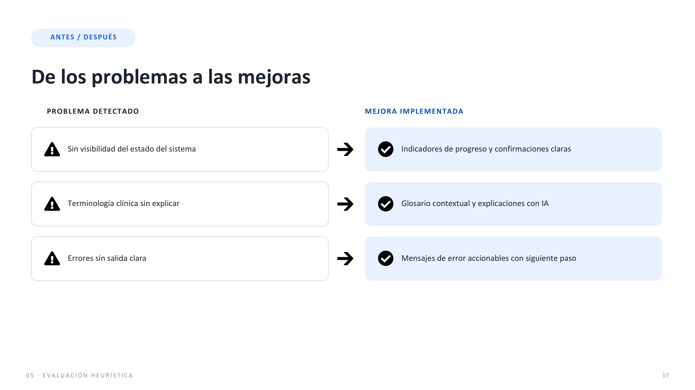
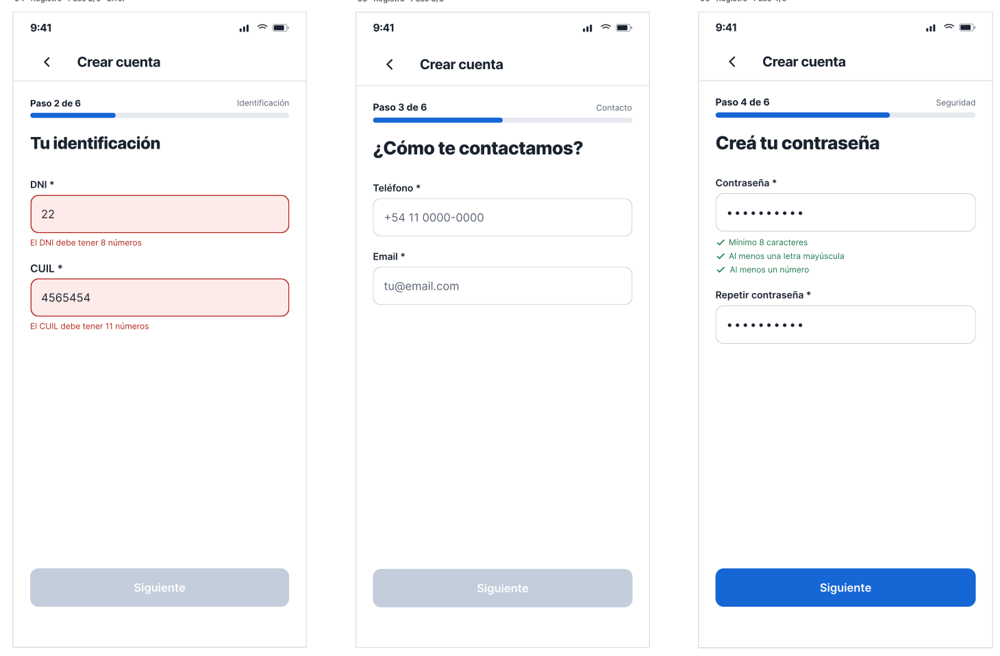
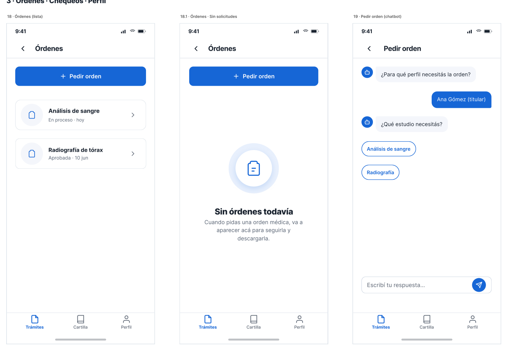
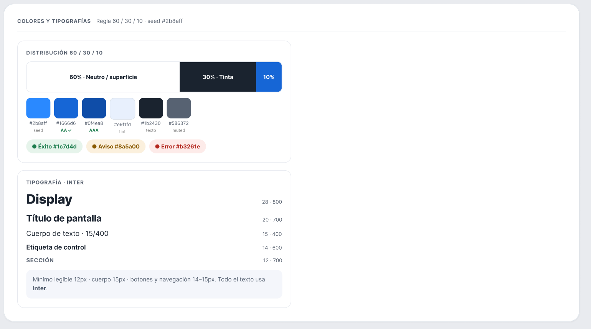
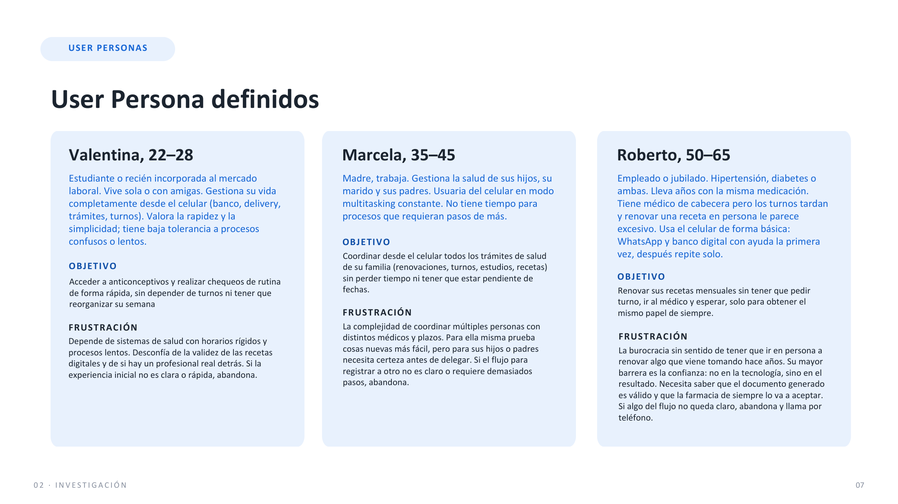

# Entelai Doc: rediseño UX/UI de una app de salud digital

**[🎨 Ver el diseño en Figma](https://www.figma.com/design/Rq0k8nTcjRNMJaD5Pbj9YO/TP-UXUI?node-id=0-1)** · **[📊 Ver la presentación](https://docs.google.com/presentation/d/1CRd1IuXqM9d5DeNfSSOasFlJLp66oJve05f_wvIYNe0/edit?usp=sharing)**

> ⚠️ **Proyecto puramente académico.** Lo hicimos como trabajo práctico de la facultad (UTN-FRBA) tomando Entelai Doc como caso de estudio. No tiene ninguna relación con la empresa Entelai: no fue encargado, revisado ni avalado por ella. Los diseños son propuestas del equipo.

## De qué se trata

Trabajo práctico de UX/UI (UTN-FRBA, 2026), hecho en un equipo de 4. Entelai Doc permite pedir recetas, órdenes médicas y chequeos a través de un chatbot de WhatsApp con IA, y un médico los aprueba. Detectamos que ese formato no permite ver el historial de trámites ni saber en qué estado está cada pedido, así que **rediseñamos la experiencia como una app mobile**.

Hicimos la **investigación con usuarios reales**:
- **Entrevistas semiestructuradas** sobre cómo resuelven hoy sus trámites médicos.
- Un **test en vivo** del chatbot actual con una usuaria.
- Con lo observado, armamos un **mapa de empatía**, una **user persona** y un **customer journey map** del pedido de recetas.

**Lo que encontramos:**
- Los **textos largos generan abandono inmediato** ("Yo no leo esto, es un montón").
- Un **error al cargar el mail, sin forma clara de corregirlo**, casi hace que la usuaria deje el trámite.
- Para confiar, la gente necesita **ver que un médico real revisa** cada pedido.
- Después de enviar un pedido, **la espera sin información genera incertidumbre**.

Con esos hallazgos y una **evaluación heurística (Nielsen)** diseñamos un **sistema de diseño propio**:
- tipografía Inter;
- paleta azul con la regla 60/30/10;
- espaciado de 8 pt;
- modo claro y oscuro.

Sobre ese sistema hicimos **más de 70 pantallas en alta fidelidad**:
- textos cortos;
- un registro en pasos con validación al instante;
- estados claros de cada pedido ("en revisión", "aprobada");
- confirmaciones antes de las acciones que no se pueden deshacer.

Todo cumple **WCAG 2.2 AA**: contraste de 4,5:1 y áreas táctiles de 44×44.

## Del problema a la mejora

## Registro en pasos, con validación al instante

## Órdenes médicas: lista, estado vacío y pedido guiado

## Sistema de diseño

## User persona

**Equipo:** Mateo Spadoni, Uriel Julián Bove, Ezequiel Fernández y Juan Bautista Delupí.
